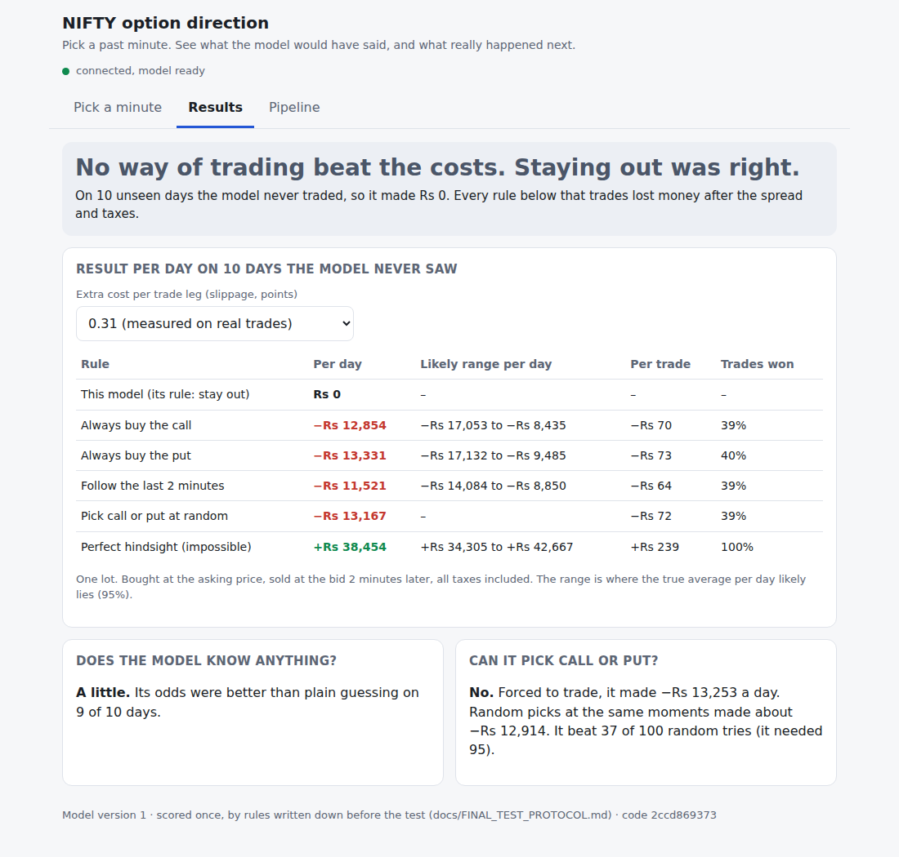

# Options-Prediction-using-AiOps

DA3408 course project: predict, each minute, whether buying the ATM NIFTY call,
buying the put, or staying out pays **after costs** over the next 2 minutes.
Design and every decision with its reason: [docs/HLD.md](docs/HLD.md).

**Result:** no tradable edge on 10 locked test days; the model correctly chose to stay out
([docs/RESULTS.md](docs/RESULTS.md)).



*Ravion* (named below) is the author's own live trading system on the same server. Its recorder holds the
market data. This project reads a frozen copy of it and never writes to it.

## Setup (on the VPS)

```bash
git clone <this repo> && cd Options-Prediction-using-AiOps
python3 -m venv .venv && . .venv/bin/activate
pip install -r requirements.txt && pip install -e .
```

## Stage 1 — export (read-only copy out of Ravion's ClickHouse)

```bash
export CH_PASSWORD="$(grep '^CLICKHOUSE_PASSWORD=' ~/Ravion-V2/.env | cut -d= -f2-)"
python -m optpred.export --dry-run   # rows per day per table, writes nothing
python -m optpred.export             # writes data/raw/<table>/<day>.parquet + manifest.json
```

Every run is journaled: `logs/<stage>/<run_id>.log` + one line in `runs/runs.jsonl`
(git commit, params hash, duration, exit code, summary). Commit both after a run:

```bash
git add logs runs && git commit -m "run: export" && git push
```

## Stages 2-6 — the pipeline (inside the pipeline image)

```bash
./pipe build                                  # once, ~5-8 min
./pipe python -m optpred.check
./pipe python -m optpred.bars
./pipe python -m optpred.features
./pipe python -m optpred.baselines            # train + validation only
./pipe python -m optpred.tune                 # Ray Tune: best LightGBM settings (train days only)
./pipe python -m optpred.train                # logs to MLflow, writes a new model version
./pipe python -m optpred.register             # moves the champion alias only if better on validation
# v2 (docs/V2_PROTOCOL.md): second-level microstructure model with barrier exits
./pipe python -m optpred.ticks                # Spark: raw ticks -> one row per contract per second
./pipe python -m optpred.micro                # decision seconds, inputs, barrier trades
./pipe python -m optpred.micro_train          # walk-forward, tau, registers nifty-option-micro
./pipe dvc repro                              # or run every stage in order with DVC
# evaluate: the ONE look at the locked test days. Already run (reports/final.json); frozen in DVC.
# Its rules: docs/FINAL_TEST_PROTOCOL.md. It refuses to run a second time.
git add logs runs reports data/days.json data/splits.json && git commit -m "run: ..." && git push
```

## The web stack (MLflow, model server, API, web page, retrain runner)

```bash
cp .env.example .env && nano .env             # set ADMIN_TOKEN
./stack up -d --build                         # first build ~5 min
./stack ps                                    # everything should say "healthy"
```

| What | Address on the VPS | From your laptop (SSH tunnel) |
|---|---|---|
| Web page | http://127.0.0.1:8080 | `ssh -L 8080:127.0.0.1:8080 -L 8000:127.0.0.1:8000 -L 5050:127.0.0.1:5050 trader@<vps>` then open http://127.0.0.1:8080 |
| Backend API docs | http://127.0.0.1:8000/docs | same tunnel |
| MLflow UI | http://127.0.0.1:5050 | same tunnel |
| Grafana dashboard | http://127.0.0.1:3001 | add `-L 3001:127.0.0.1:3001` |
| Prometheus | http://127.0.0.1:9091 | add `-L 9091:127.0.0.1:9091` |

Demo feed for the dashboard: `./stack --profile demo up -d replay`.

Nothing is exposed publicly unless you set `BIND=0.0.0.0` in `.env`.

## Tests and CI

```bash
git config core.hooksPath .githooks          # once: turns on the pre-push hook (CI)
./pipe python scripts/test_report.py         # all tests -> reports/test_report.md
./pipe ruff check .
```

## Documents (`docs/`)

| Document | File |
|---|---|
| Architecture diagram and blocks | [docs/ARCHITECTURE.md](docs/ARCHITECTURE.md) |
| High-level design | [docs/HLD.md](docs/HLD.md) |
| Low-level design (endpoints, I/O) | [docs/LLD.md](docs/LLD.md) |
| Test plan and cases | [docs/TEST_PLAN.md](docs/TEST_PLAN.md), report: `reports/test_report.md` |
| Results and final test protocol | [docs/RESULTS.md](docs/RESULTS.md), [docs/FINAL_TEST_PROTOCOL.md](docs/FINAL_TEST_PROTOCOL.md) |
| User manual | [docs/USER_MANUAL.md](docs/USER_MANUAL.md) |

## Data safety

`scripts/encrypt_snapshot.sh` encrypts the frozen snapshot (GnuPG, AES-256) into `~/optpred-backups/`.
The key is `~/.optpred_snapshot.key`. It is not in the repo. Copy it somewhere safe.
`scripts/encrypt_snapshot.sh --verify <file>` proves the backup opens.
