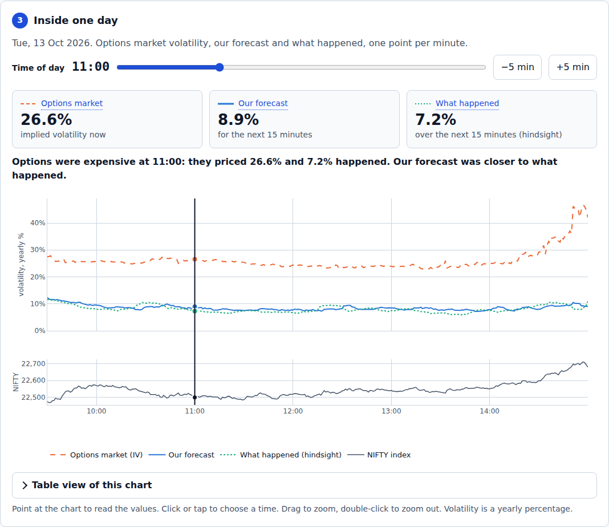

# Options-Prediction-using-AiOps

DA3408 course project. A full AIOps pipeline on my own NIFTY option data (Upstox → Ravion V2): data engineering,
tracking, gated deployment, monitoring and retraining. It forecasts **how much NIFTY will move** in the next 5 / 15
minutes (volatility), and tests whether **buying calls or puts after costs** pays (direction). It is also a signal
library for the author's trading system (Ravion V2).

**Results.**
- **Volatility: predictable.** A HAR forecaster beat the option market's implied forecast on **10 of 10** unseen test
  days (daily QLIKE −0.20, 95% interval −0.37 … −0.07) ([results](reports/vol/comparison.md)).
- **Direction: no edge.** A linear model and LightGBM against a "stay out" baseline, 39 training days, 10 later test
  days: neither beats "stay out" after costs ([results](reports/zoo/comparison.md)).

**Demo video (5 min):** [watch on Google Drive](https://drive.google.com/file/d/1_Y8OUt3Dxvzz8HPOUF5pYOPXtvjUn4Tz/view?usp=drive_link)



## Documents

| | |
|---|---|
| [Architecture](docs/ARCHITECTURE.md) | diagram, blocks, ports, versioning |
| [High-level design](docs/HLD.md) | problem, design rules, decisions, technology map |
| [Low-level design](docs/LLD.md) | every API endpoint and pipeline stage with its input and output |
| [Test plan](docs/TEST_PLAN.md) | levels, 110 test cases, acceptance criteria; report in `reports/test_report.md` |
| [User manual](docs/USER_MANUAL.md) | the web page for a non-technical user, with screenshots; operator commands |
| [CI with DVC](docs/steps/ci.md) | the DVC DAG as the CI pipeline, the acceptance gate |
| [Lifecycle steps](docs/steps/) | one short note per course step |

## Layout

```
dvc.yaml  params.yaml      the pipeline (13 stages) and every setting
src/optpred/
  data/                    stages export (ClickHouse → Parquet), check (Spark)
  eda/  transform/         stages clean, eda, grid (Ray, one task per day)
  featurelib/  labels/     stages feat, labels (costs, triple barrier)
  zoo/                     direction models: stages zoo_train, zoo_eval, deploy gate
  vol/                     volatility forecasters: stage vol
  drift/                   PSI drift: stage drift, and the online check in the API
  ci/                      stage gate (CI acceptance criteria)
  serving/                 FastAPI: the only thing the web page talks to
  common/                  session clock, run journal, Spark and Ray helpers
tests/                     unit, integration, api, e2e, ui (browser audit)
frontend/                  the web page (static, nginx)
monitoring/                Prometheus, alert rules, Alertmanager, Grafana dashboard
docker/  docker-compose.yml   images and the serving stack
pipe  stack                the two entry scripts
scripts/                   retrain runner, model server start, demo replay, test report, backup
scripts/docs/              diagrams, screenshots, demo video
reports/                   metrics and plots written by the stages (in Git)
logs/                      stage logs and the run journal runs.jsonl (in Git)
data/                      DVC data (not in Git); data/sample = one day in Git LFS
docs/                      the documents listed above
MLproject                  the same stage commands as MLflow entry points
```

## Run it

You need Linux, Docker with Compose, Git LFS, and `curl`. Ports 8080, 8000, 5050, 3001 and 9091 must be free.
Windows and macOS are not tested.

**A. Start the application with the trained models** (download 0.9 GB, free disk 8 GB with the Docker images).

```bash
git clone https://github.com/rinkesh-1612/Options-Prediction-using-AiOps.git
cd Options-Prediction-using-AiOps
scripts/get_data.sh app
cp .env.example .env
./stack up -d --build        # page 8080, API 8000, MLflow 5050, Grafana 3001
```

Open <http://127.0.0.1:8080>. `make demo` replays the unseen days, so that Grafana moves.
Stop it with `./stack stop replay`, then `./stack restart api`.

**B. Rebuild everything from the raw recordings** (download 4.4 GB, free disk 30 GB). Use a new clone.

```bash
scripts/get_data.sh raw
./pipe build                 # pipeline image (Python, Java/Spark, Ray, LightGBM)
make rebuild                 # every stage after export; 75 min on 8 CPUs and 24 GB of memory
./stack up -d --build
```

The result files in `reports/` must then show the same test results. Only the model version numbers change, because
the new registry starts at version 1. The `export` stage is not run: it reads my private ClickHouse database, and the
raw download is its output, with the hash in `dvc.lock`.

**Tests and CI.**

```bash
make test                    # all tests; synthetic data, so no download is needed
make ci                      # CI: ./pipe dvc repro gate (needs the data of step B)
git config core.hooksPath .githooks   # run the CI before every push
```

`make help` lists the other commands.

AI use: [AI_DISCLOSURE.md](AI_DISCLOSURE.md).
