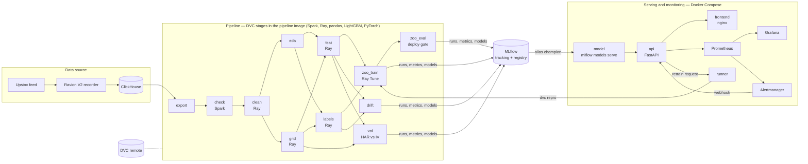

# Architecture

One VPS, no cloud. Everything runs in Docker: the pipeline in one image (`./pipe`), the services with
Docker Compose (`./stack`). Ravion V2 (the author's live trading system) records the market data.

| Block | What it does | Where |
|---|---|---|
| export | Copies the raw tables from ClickHouse to Parquet, read-only, row counts verified | `src/optpred/data/export.py` |
| check | Spark: accepts or rejects each day (coverage, frozen feed) | `src/optpred/data/check.py` |
| clean, eda | Ray tasks per day: outlier rules, missing values, profile and plots | `src/optpred/eda/` |
| grid | One aligned row per second: index, future, ATM ±2 option legs, ATM chain | `src/optpred/transform/` |
| feat | Feature library: registered, look-ahead-tested features | `src/optpred/featurelib/` |
| labels | Triple-barrier outcome of buying the ATM call / put each second | `src/optpred/labels/` |
| zoo_train | Walk-forward CV of 9 model families, Ray Tune, MLflow | `src/optpred/zoo/train.py` |
| zoo_eval | Test-day scores, champion chosen on CV, smoke test, deployment | `src/optpred/zoo/evaluate.py`, `promote.py` |
| vol | Second model: forecast of the NIFTY move over the next 5 / 15 min vs the implied move; registered `nifty-vol` | `src/optpred/vol/` |
| drift | PSI per day against the training days; reference for online drift | `src/optpred/drift/` |
| model | Serves the registry alias `nifty-signal@champion`; rolls back if a version does not start | `scripts/serve_model.sh` |
| api | The only public entry: signals, volatility forecasts (loads `nifty-vol`), results, pipeline, rollback, retrain, metrics | `src/optpred/serving/signal_api.py` |
| frontend | Static web page (4 tabs); knows only the API address | `frontend/` |
| Prometheus, Alertmanager, Grafana | Metrics every 5 s, 8 alert rules, one dashboard | `monitoring/` |
| runner | Runs `zoo_train` → `zoo_eval` when a retrain is requested (alert, button, schedule) | `scripts/runner.sh` |

**Ports** (bound to `127.0.0.1` unless `BIND` is set): web page 8080, API 8000, MLflow 5050, Grafana 3001,
Prometheus 9091.

**Versioning.** Git: code, configs, reports, run journal. Git LFS: one sample day. DVC: all data, local remote.
MLflow registry: models (aliases `champion`, `previous`; tag `deploy_check`). Encrypted backup of data and
models: `scripts/encrypt_snapshot.sh`.
