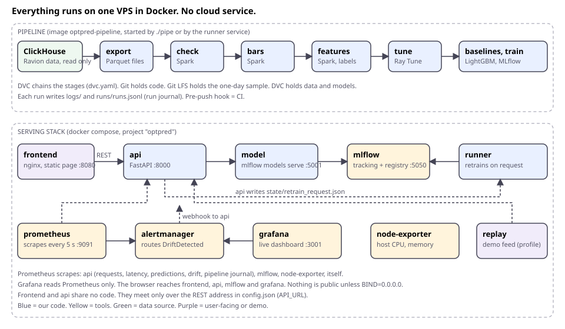

# Architecture

The system has two parts. The **pipeline** turns recorded market data into a model.
The **serving stack** shows the model to a person and watches it.
Both run in Docker on one VPS. No cloud service is used.

## Blocks

| Block | Tool | Job | Talks to |
|---|---|---|---|
| ClickHouse (Ravion) | ClickHouse | Holds the recorded option ticks. Ravion is the author's own trading system on this server. We read it. We never write to it. | export |
| export | Python | Copies each day to a Parquet file. Writes a manifest. | ClickHouse, data/raw |
| check | Spark | Rejects bad days: holidays with frozen prices, outages, thin days. | data/raw |
| bars | Spark | Turns ticks into one-minute bars. | data/raw |
| features | Spark | Builds the features and the three labels for each minute. | data/bars |
| tune | Ray Tune | Searches LightGBM settings on train days only. | data/features |
| baselines | Python | Scores simple rules with the same simulator and costs. | data/features |
| train | LightGBM, MLflow | Trains the model, picks the trade threshold on validation, logs a new model version. | MLflow |
| register | MLflow registry | Points `candidate` at the new version. Moves `champion` only if it is better on validation. Keeps `previous` for rollback. | MLflow |
| evaluate | Python, MLflow | Scores the champion **once** on the locked test days. Frozen in DVC afterwards. | MLflow, reports/final.json |
| mlflow | MLflow | Stores runs, metrics, artifacts. Holds the model registry and its aliases. | model, api |
| model | `mlflow models serve` | Serves the champion model over REST. Follows the alias. | mlflow |
| api | FastAPI | The only back end. Predicts, shows the pipeline, rolls back, retrains, exports metrics. | model, mlflow |
| frontend | nginx | A static web page. It calls the api over REST. | api |
| runner | shell loop | Runs `train` when the api writes a retrain request. | state/ |
| prometheus | Prometheus | Pulls metrics every 5 seconds. Evaluates alert rules. | api, mlflow, node-exporter |
| alertmanager | Alertmanager | Sends the `DriftDetected` alert to the api. | api |
| grafana | Grafana | Draws the live dashboard. | prometheus |
| node-exporter | node-exporter | Reports host CPU, memory, disk. | prometheus |
| replay | Python | Sends a past day to the api minute by minute (demo). | api |

## Data flow

1. `export` copies ClickHouse data to `data/raw/<table>/<day>.parquet`.
2. `check` writes `data/days.json` (accepted and rejected days) and `reports/quality.json`.
3. `bars` and `features` write `data/bars` and `data/features/features.parquet`.
4. `train` reads only train and validation days. It writes a model version to MLflow. `register` decides which version is `champion`.
   `evaluate` scored the champion once on the locked test days (`reports/final.json`, shown on the Results tab).
5. The `model` service loads the champion. The `api` calls it. The page calls the `api`.
6. Each prediction increments Prometheus counters. Grafana shows them.
7. The `api` compares the recent inputs with the training inputs (drift).
   When drift stays high, Prometheus fires `DriftDetected`. Alertmanager calls the `api`.
   The `api` writes a retrain request. The `runner` trains a new model.
   The new model becomes champion only if it validates better.
8. A person can roll back. The `api` moves the `champion` alias to the `previous` version.
   The `model` service sees the change in 10 seconds and restarts on that version.

## Why the blocks are separate

* The page and the `api` share no code. A person can replace either one.
* The `model` service is separate from the `api`. A rollback needs no `api` restart.
* The pipeline image holds Java and Spark. The serving image does not. It is small.
* Prometheus pulls from the `api`. The pipeline runs and stops, so it writes a journal.
  The `api` turns that journal into metrics at each scrape.
* Not scraped directly: the `frontend` (static files, no logic) and the `runner` (its runs appear in the journal,
  so the `api` exports them). The `model` service is watched through the `api` (`model_up`, prediction latency).

## Ports (all on 127.0.0.1 unless `BIND=0.0.0.0`)

| Port | Service |
|---|---|
| 8080 | web page |
| 8000 | api (`/docs` shows the interactive documentation) |
| 5050 | MLflow |
| 9091 | Prometheus |
| 3001 | Grafana |

Ports 3000 and 9090 belong to another project on this server. We do not use them.
