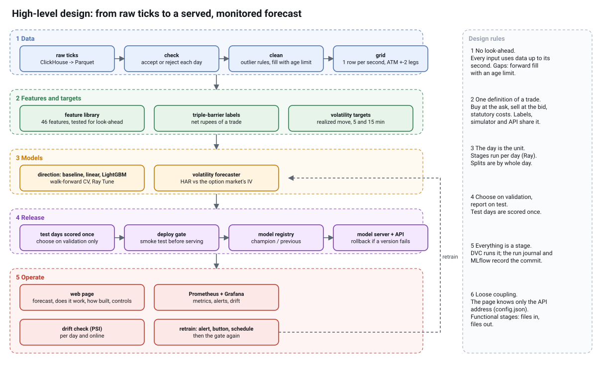

# High-level design

## 1. Problem and goal

I trade NIFTY options. The question: at each second, should I buy the ATM call, buy the ATM put, or stay
out, after all costs? The system must answer this with a controlled AIOps pipeline, and it must become a
reusable signal library for Ravion V2. Success metric: **net ₹ per day after costs on test days that no
model was trained or tuned on**, with a 95% bootstrap interval over days, against baselines.

Results: **direction — no edge detected** (`reports/zoo/comparison.md`). **Volatility — predictable:** a second
model forecasts the NIFTY move over the next 5 / 15 min and beats the option market's implied forecast on 10 of 10
test days (`reports/vol/comparison.md`). The forecast is not a trade by itself (buying straddles on it did not pay after the spread, in a separate study that
is not part of this submission); for Ravion it is a filter and sizing input.

*Five layers from raw ticks to a served, monitored forecast, and the rules that hold them together. Source:
`scripts/docs/make_diagrams.py`. The runtime picture (containers, ports) is in [ARCHITECTURE.md](ARCHITECTURE.md).*

## 2. Design rules

1. **No look-ahead.** Every feature uses only data up to its second (tested for every feature). Gaps are
   filled forward with an age limit, never backward or by interpolation.
2. **One definition of a trade.** Entry at the ask, exit at the bid, statutory costs (checked against the
   author's contract note). The labels, the simulator and the API use the same code.
3. **Day is the unit.** Stages work per day (Ray tasks); splits are by whole day; a trade never crosses a day.
4. **Choose on validation, report on test.** Champion and threshold come from walk-forward CV on the dev days.
   The test days only report.
5. **Everything is a stage.** DVC runs it; the run journal (`logs/runs.jsonl`) records commit, parameters,
   duration and result; MLflow records models and metrics with the commit and the DVC data hashes.

6. **Functional stages, small classes where state is needed.** Every pipeline stage is a function: files in, files
   out, no hidden state (`dvc.yaml` is the call graph). Classes are used only where an object holds state or a
   contract: the model families (`fit` / `predict_day`), the registered feature, the API application.
7. **Loose coupling.** The web page and the model are separate blocks that talk only through configurable REST
   calls: the page knows one address (`config.json`), the API is the only entry, the model server is never exposed.
   A test checks that every path the page calls is in the LLD.

## 3. Main decisions

| Decision | Why | Not chosen |
|---|---|---|
| 1-second ATM-relative grid | Keeps the order-flow detail; minute data can be made from it | Minute bars (loses detail) |
| Triple-barrier labels (σ-scaled take-profit / stop-loss, time cap) | The holding time follows the market; not fixed | One fixed horizon |
| Three models per question: a baseline, a simple model, a better model (direction: stay out, ridge, LightGBM; volatility: option market, HAR, HAR + IV) | A model counts only if it beats the baseline on one label, one split, one simulator. Six more direction families (deep models included) were tried and removed: none beat the baseline, and they made the project hard to explain | One model with no baseline |
| Feature library with a registry | Add a feature = one function; CI tests it automatically | Hand-written feature table |
| Deploy gate + alias-following server | Promotion = deployment; a bad version never serves; automatic rollback | Manual restarts |
| Drift limits from normal dev-day variation | Fixed PSI limits flagged 45 of 49 normal days | One global PSI limit |
| Second target: volatility (HAR vs implied IV, QLIKE) | Direction has no signal (corr ≈ 0.01); volatility clusters (corr ≈ 0.68) | More direction models |
| pandas + Ray per day; Spark for the day check | Per-day data fits in memory; Ray gives parallel days; Spark scans all 114 M raw rows | Spark for every stage |

## 4. Technology (course guideline → this project)

| Guideline | Used |
|---|---|
| Version control: Git, Git LFS, DVC | Git (code, reports, journal), LFS (sample day), DVC (data, remote) |
| Data engineering: Spark, Ray | Spark (`check`), Ray tasks (all per-day stages), Ray Tune (training) |
| Experiment tracking: MLflow | Experiments `nifty-zoo`, `nifty-vol`; registry `nifty-signal`, `nifty-vol` (section 6) |
| Containerization: Docker, Compose, Docker Hub | Pipeline image, serving image (multi-stage), frontend image, Compose stack. Images are built locally; they are not pushed to Docker Hub |
| CI/CD: DVC | DAG ends in `tests` → `gate`; `dvc repro gate` = lint, tests, training, evaluation, gated deployment, acceptance (pre-push hook runs it) |
| Serving: MLflow Serve, Ray Serve, REST | `mlflow models serve` behind the FastAPI API. Ray Serve is not used |
| Monitoring: Prometheus, Grafana | Metrics of every component, 10 alerts, dashboard; Alertmanager → retraining |
| No cloud | One self-managed VPS |

## 5. Best practices

- **Code quality:** ruff (PEP 8), docstrings in every module, one requirements file.
- **Testing:** unit, integration, API and end-to-end tests ([TEST_PLAN.md](TEST_PLAN.md)).
- **Security:** AES-256 encrypted backup of data and models; admin token for rollback and retraining;
  services bound to localhost by default; ClickHouse read-only.
- **Scalability:** the work grows with the number of days; days run in parallel on Ray (CPU limit in
  `params.yaml`, so live trading keeps its CPUs). New days = `dvc repro`.
- **Explainability:** global: gain importance and group ablation for the champion (Results tab, MLflow). Per signal:
  exact SHAP values of the score (`/signal` → `drivers`; Explore step 4, "Why did it say that?"). They add up to the score.
- **Collaboration:** shared MLflow UI, Grafana, Git history, `docs/steps/` (one short note per lifecycle step).

## 6. Experiment tracking: what MLflow records

Experiments `nifty-zoo` (direction models, drift) and `nifty-vol` (volatility forecasters); registered models
`nifty-signal` and `nifty-vol` (aliases `champion`, `previous`; tag `deploy_check`).

| Kind | What is recorded |
|---|---|
| Parameters | every model setting of the grid, the family, the threshold quantile |
| Metrics | cross-validation net ₹/day, trades, hit rate, Sharpe, drawdown, IC per fold; test metrics with the 95% interval; QLIKE and correlation for the volatility forecasters |
| Artifacts | the model (pyfunc), feature importance, the group ablation, drift per day |
| **Beyond autolog** | the **Git commit** and `git_dirty`, the **DVC hash** of the feature and label data, the dev and test day ranges, per-fold results, the deploy-gate result (`deploy_check`), the drift series over time |

## 7. Monitoring: what is watched, and are all components covered?

| Component | How it is monitored |
|---|---|
| api | Prometheus scrapes it every 5 s: requests, latency, signals by action, served trades won / lost and net ₹, volatility forecasts, drift, data quality, last run of every stage |
| model server | blackbox probe of `/ping` (`probe_success`), `model_service_up` (the api pings it), `model_call_seconds`; the server also checks itself and rolls back |
| mlflow | scraped directly (`job=mlflow`), health check in Compose |
| host | node-exporter: CPU, memory, disk |
| pipeline stages | `pipeline_last_run_ok{stage}` from the run journal; alert `PipelineStageFailed` |
| frontend (static nginx) | blackbox probe of the page (`probe_success`); alert `ComponentDown` |
| retrain runner | heartbeat file → `runner_heartbeat_age_seconds` (api); alert `RunnerDown` |
| Prometheus, Alertmanager, Grafana | each scraped directly; `up` of every target; alert `TargetDown` |

Ten alert rules (`monitoring/alerts.yml`): DriftDetected, ModelLosing, LowHitRate, ModelServiceDown, TargetDown,
ComponentDown, RunnerDown, PipelineStageFailed, SlowApi, BadDataRate. Grafana refreshes every 5 s; panel
"Components up" shows every component. The api logs every 4xx / 5xx request and every unhandled error.

## 8. Speed and throughput

Measured from the run journal and shown live in the "How it's built" tab (table "Speed").
Data engineering: `check` (Spark) reads 86 M raw option ticks at about 350,000 rows/s; `clean` (Ray, 2 CPUs) cleans
111 M ticks in about 4 minutes; `grid` builds 1.1 M one-second rows from 106 M clean ticks in about 90 s. Whole
pipeline from clean data to a registered, deployed model: about 30 minutes on a quiet server (training dominates). One signal:
about 90 ms through the API.
