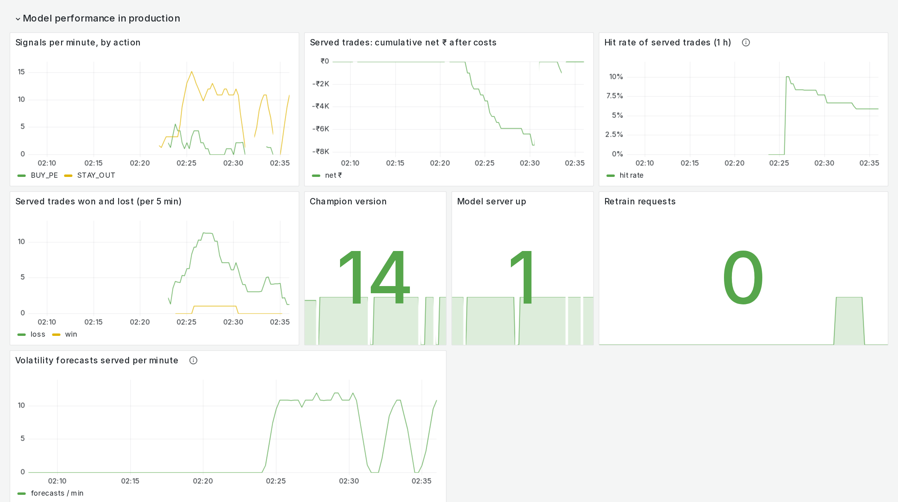

# User manual

For a trader. No programming is needed to use the page. The sections "Controls" and "For the operator" are for the person who runs the server.

Open **http://&lt;server&gt;:8080** (on this server: http://<server-ip>:8080).

## What this page does, in one minute

It replays real NIFTY market days and answers two questions at any moment of the trading day:

1. **How much will NIFTY move in the next 5 or 15 minutes?** Our forecast beat the options market's own guess on every
   one of 10 days that the model had never seen. This part works.
2. **Should I buy a call or a put?** The model that tries to answer this lost money after costs on days it had never
   seen. The page shows it so that you can see how it decides, and it says clearly that it is **not proven**.

The page is **not** investment advice. It is a research system built on recorded market data.

## The screen

At the top: the name, a **status light** (green = everything normal; press it for details), a **Help** button (always
in the same place) and four tabs: **Explore**, **Results**, **How it's built**, **Controls**. On a phone the tabs are at
the bottom of the screen, where your thumb is. The dark version follows your device setting.

 

## Explore: five steps, top to bottom


On the first visit a short **guided tour** opens (close it any time; reopen it with **Show the guided tour**). The
buttons under the title jump to each step.

1. **Pick a day** in the calendar. ★ = unseen day (a fair test); E = expiry day; ! = big move; ~ = market-change alarm;
   a dashed day has no data.
2. **Implied volatility** (IV), four views: IV over the days, IV against our forecast and what happened, the smile (IV by
   strike) and the term structure (IV by expiry). Click a dot to pick that day.
3. **Inside one day**: IV, our forecast and what happened, one point per minute, with the NIFTY index below. Click the
   chart or drag the slider to pick a time; **−5 min / +5 min** step through time. Three boxes and one sentence say who
   was closer at that time.
4. **Call or put at that moment?** The second model answers: **Buy a call**, **Buy a put** or **Stay out**. A yellow
   notice says that this model is **not proven**. Open **"Why did it say that, and what happened next?"** to see the
   expected result of each side, the inputs that pushed the answer most, and what the trade would really have made.
5. **Verdict** in plain words: the forecast of how much NIFTY moves works; call/put prediction shows no edge after costs.

Every chart is interactive: point at it (or press and hold on a phone) to read the values, drag to zoom, double-click to
zoom out, click a legend name to hide a line. **Table view of this chart** shows the same numbers as a table.

## Results


Two verdict cards, the three rules of the test, and folded sections with all the numbers (open what you need): the
three volatility forecasters, the three call/put models with their 95% intervals, whether the market has changed, and
what the call/put model looks at.

## Words you may not know

Any word with a dotted underline is a button: press it and a short explanation appears. The **Help** button shows
all of them in one list, with a short guide to the page.


## How it's built


The factory behind the forecast. Each box is a step that turns raw data into a model. A green border means its last run
succeeded; red means it failed. Press a box to filter the runs; press a run to read its log. Below: the speed of each
step in rows per second, and the data quality (days that were rejected and why, rows that cleaning removed).
**Recent runs** starts with a count (for example "47 runs: 41 succeeded, 6 failed"); **Failed only** lists only the
failures, and a click on a run shows its log with the error.

## Controls (for the operator)


- **Is everything healthy?** A list with a green tick, an amber warning or a red cross for each part.
- **Models in use.** The current call/put model and the previous one (the way back), each with its safety check.
- **Actions.** *Go back to the previous model*, *Retrain the models* and *Run the pipeline* (reruns only the steps
  whose code, data or settings changed, then all tests and the final check). Each asks you to confirm and needs the
  admin token (field above the buttons). Follow a run in **How it's built**.
- **Other tools.** Links to MLflow (experiments and models) and Grafana (live monitoring).




## Using the keyboard

`Tab` moves between controls and shows a blue outline on the current one. The arrow keys change the time slider and move
between the four tabs. `Esc` closes the Help window and any explanation. A link at the very top ("Skip to content")
appears on the first `Tab`.

## When something goes wrong

The page never shows a raw error. A red box says what happened in plain words and has a **Try again** button.

| Message | Meaning | What to do |
|---|---|---|
| We can't reach the forecast service | the server or the API container is stopped | `./stack up -d api` on the server |
| The model is starting up or not available yet | the model server is starting or down | wait one minute; `./stack logs model` |
| data for … is not available now | the pipeline is rebuilding the data | wait for `dvc repro` to finish |
| admin token missing or wrong | going back or retraining needs the token | enter the token on the Controls tab |
| there is no previous model to roll back to | nothing to go back to | nothing to do |

## For the operator: start, stop, update

```bash
./stack up -d --build          # start everything (page 8080, API 8000, MLflow 5050, Grafana 3001)
./stack ps                     # state of each service
./stack down                   # stop (data stays)
./pipe dvc repro               # run the pipeline; a new model is served only if it passes the safety check
make e2e                       # check the running stack
make demo                      # replay the unseen days through the API (Grafana moves); stop: ./stack stop replay
make ui                        # browser audit of this page (errors, phone width, contrast, keyboard)
bash scripts/encrypt_snapshot.sh            # encrypted backup of data and models
```
Settings are in `params.yaml`. The admin token is the environment variable `ADMIN_TOKEN` (empty = no token).
