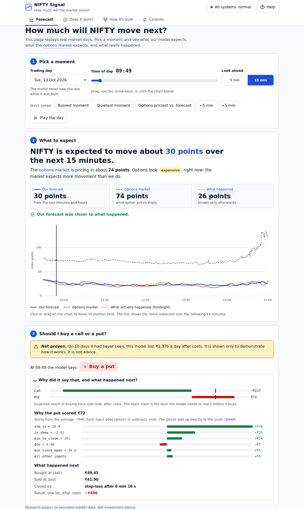
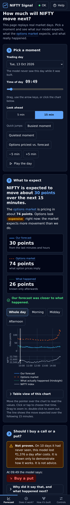
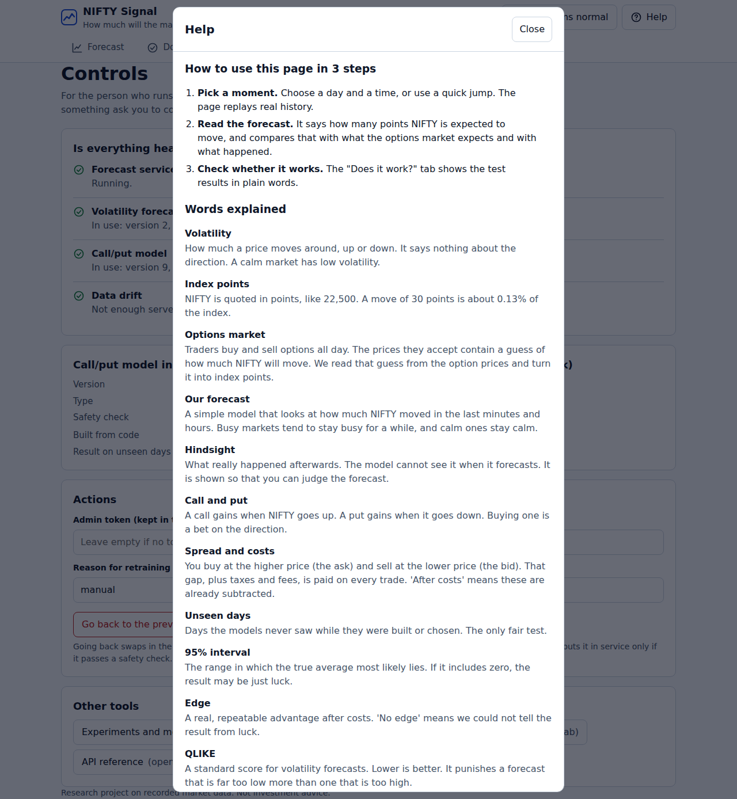
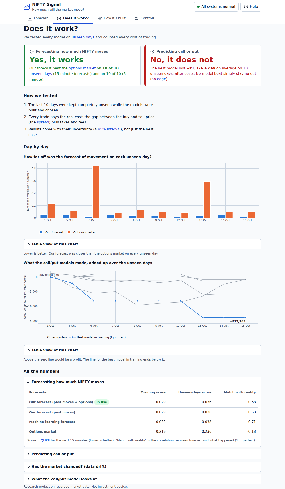
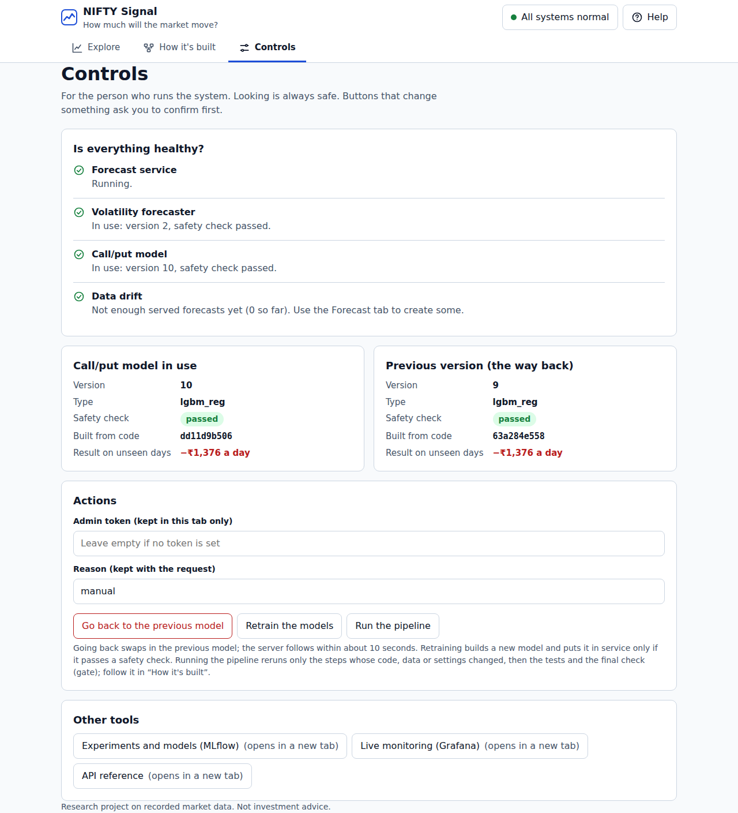

# User manual

For a trader. No programming is needed to use the page. The last two sections are for the person who runs the server.

Open **http://&lt;server&gt;:8080** (on this server: http://<server-ip>:8080).

## What this page does, in one minute

It replays real NIFTY market days and answers two questions at any moment of the trading day:

1. **How much will NIFTY move in the next 5 or 15 minutes?** Our forecast beat the options market's own guess on every
   one of 10 days that the model had never seen. This part works.
2. **Should I buy a call or a put?** The model that tries to answer this lost money after costs on days it had never
   seen. The page shows it so that you can see how it decides, and it says clearly that it is **not proven**.

The page is **not** investment advice. It is a research system built on recorded market data.

## The Explore page (new first tab)

The page opens with a short **guided tour** (close it any time; reopen with "Show the guided tour"). Then, top to bottom:
1. **Pick a day** in the calendar. ★ = unseen day (a fair test); E = expiry day; ! = big move; ~ = market-change alarm.
2. **Implied volatility** (IV), four views: IV over the days, IV against our forecast and what happened, the smile (IV by
   strike) and the term structure (IV by expiry). Click a dot to pick that day; use the time slider for smile and term.
3. **Inside one day**: IV, our forecast and what happened by the minute, with the NIFTY index below. Click the chart to pick a
   time. Every chart has a "Table view" with the same numbers.

4. **Strategies at that moment**: 18 ready-made strategies priced at the chosen time (cost to open, result after 5, 15, 30 and 60
   minutes, best exit in hindsight, best profit and worst loss at expiry). Switch to "Close by the barrier rule" to see how each
   would end under a take-profit / stop-loss rule. Click a row for the result-by-closing-time chart and the payoff diagram. "Build your
   own" prices any 1-4 leg strategy, including unbalanced ones (for example buy 1, sell 2).

5. **What each model said**: at the chosen time, the volatility forecasts against what happened, and each direction model's call,
   put or stay-out with the money it would have made. A badge says whether the day is a fair test for that model. A chart shows
   the whole day.

Steps 6 and 7 (the alpha test, the verdict) are being built. The older
**Forecast** and **Does it work?** pages are described below and stay reachable at `#forecast` and `#works`.

## The screen



At the top: the name, a **status light** (green = everything normal; press it for details), a **Help** button
(always in the same place) and four tabs: **Forecast**, **Does it work?**, **How it's built**, **Controls**.
On a phone the tabs are at the bottom of the screen, where your thumb is.

### Forecast: three steps, top to bottom

**1. Pick a moment**
- **Trading day.** Days marked *unseen* were never used to build the model, so they are the fair test.
- **Time of day.** Drag the slider, use the arrow keys, or click on the chart.
- **Look ahead.** 5 or 15 minutes.
- **Quick jumps.** *Busiest moment* and *Quietest moment* jump to the biggest and smallest movement of the day.
  *Options priciest vs. forecast* jumps to where the options market expected much more movement than we did.
  *−5 min / +5 min* step through time. *Play the day* runs the day like a live feed; press it again to pause.

**2. What to expect.** One sentence in plain words, for example:
*"NIFTY is expected to move about 30 points over the next 15 minutes. The options market is pricing in about 74
points. Options look expensive right now."* Under it, three boxes: **our forecast**, **what the options market
expects**, and **what happened** (known only afterwards, so it is shown as hindsight). A line tells you who was closer.
The **chart** shows the three over the whole day:

| Line | Meaning |
|---|---|
| solid blue | our forecast |
| dashed orange | the options market's expectation |
| dotted green | what actually happened afterwards |

The NIFTY index is drawn below. The black vertical line is the selected time. The chart is interactive:
point at it (or press and hold on a phone) to read the exact values of all lines; click or tap to move the selected time;
drag to zoom in, double-click to zoom out; the buttons **Whole day / Morning / Midday / Afternoon** zoom to a part of the day;
click a name in the legend to hide or show a line. **Table view of this chart** shows the same numbers as a table.

**3. Should I buy a call or a put?** A yellow notice reminds you that this model is not proven, with its real result on
unseen days. Below it the model's answer for the selected moment: **Buy a call**, **Buy a put** or **Stay out**. Open
**"Why did it say that, and what happened next?"** to see the expected result of each side, the five inputs that
pushed the answer most (they add up exactly to the score), and what the trade would really have made.


The dark version follows your device setting:



### Words you may not know

Any word with a dotted underline is a button: press it and a short explanation appears. The **Help** button shows
all of them in one list, with the 3-step guide.



### Does it work?



Two verdict cards in words: **"Yes, it works"** for the forecast of movement, **"No, it does not"** for call/put
prediction, each with its numbers. Below are the three rules of the test, and folded sections with all the numbers (open
what you need): the forecasters, the call/put models with their 95% intervals, whether the market has changed, and what the
call/put model looks at.

### How it's built


The factory behind the forecast. Each box is a step that turns raw data into a model. A green border means its last run
succeeded; red means it failed. Press a box to filter the runs; press a run to read its log. Below: the speed of each
step in rows per second, and the data quality (days that were rejected and why, rows that cleaning removed).

### Controls (for the operator)



- **Is everything healthy?** A list with a green tick, an amber warning or a red cross for each part.
- **Models in use.** The current call/put model and the previous one (the way back), each with its safety check.
- **Actions.** *Go back to the previous model* and *Retrain the models*. Both ask you to confirm. They need the admin
  token (field above the buttons).
- **Other tools.** Links to MLflow (experiments and models) and Grafana (live monitoring).


## Using the keyboard

`Tab` moves between controls and shows a blue outline on the current one. The arrow keys change the time slider and move
between the four tabs. `Esc` closes the Help window and any explanation. A link at the very top ("Skip to content")
appears on the first `Tab`.

## When something goes wrong

The page never shows a raw error. A red box says what happened in plain words and has a **Try again** button.

| Message | Meaning | What to do |
|---|---|---|
| We can't reach the forecast service | the server or the API container is stopped | `./stack up -d api` on the server |
| The model is starting up or not available yet | the model server is starting or down | wait one minute; `./stack logs model` |
| data for … is not available now | the pipeline is rebuilding the data | wait for `dvc repro` to finish |
| admin token missing or wrong | going back or retraining needs the token | enter the token on the Controls tab |
| there is no previous model to roll back to | nothing to go back to | nothing to do |

## For the operator: start, stop, update

```bash
./stack up -d --build          # start everything (page 8080, API 8000, MLflow 5050, Grafana 3001)
./stack ps                     # state of each service
./stack down                   # stop (data stays)
./pipe dvc repro               # run the pipeline; a new model is served only if it passes the safety check
make e2e                       # check the running stack
make ui                        # browser audit of this page (errors, phone width, contrast, keyboard)
bash scripts/encrypt_snapshot.sh            # encrypted backup of data and models
```
Settings are in `params.yaml`. The admin token is the environment variable `ADMIN_TOKEN` (empty = no token). The design
of the page and how it was tested are in [UI_DESIGN.md](UI_DESIGN.md).
