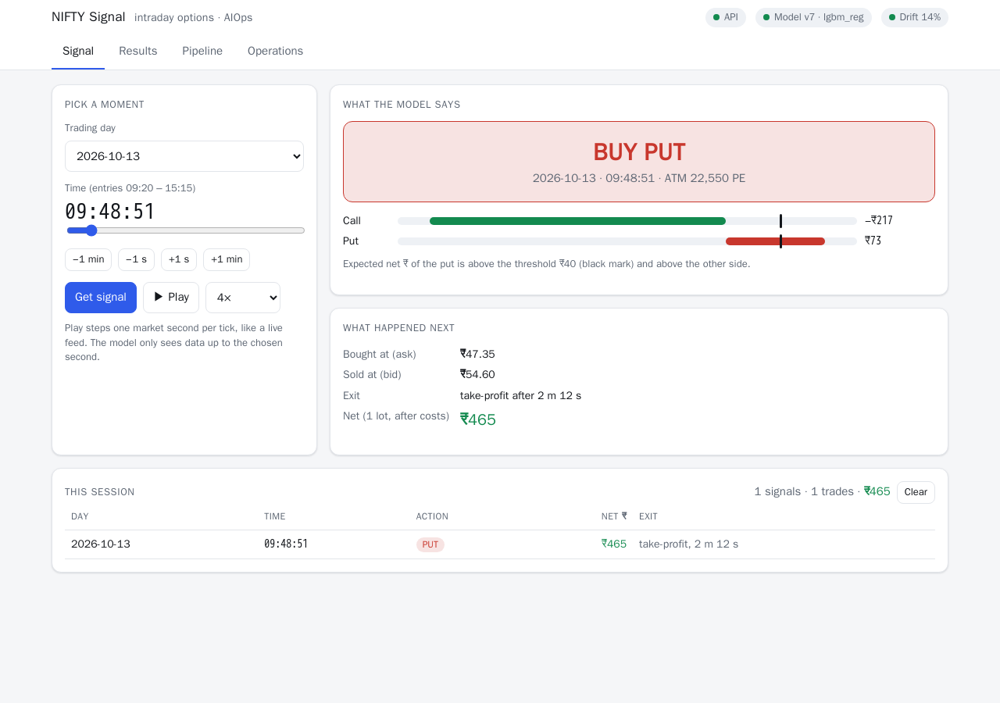
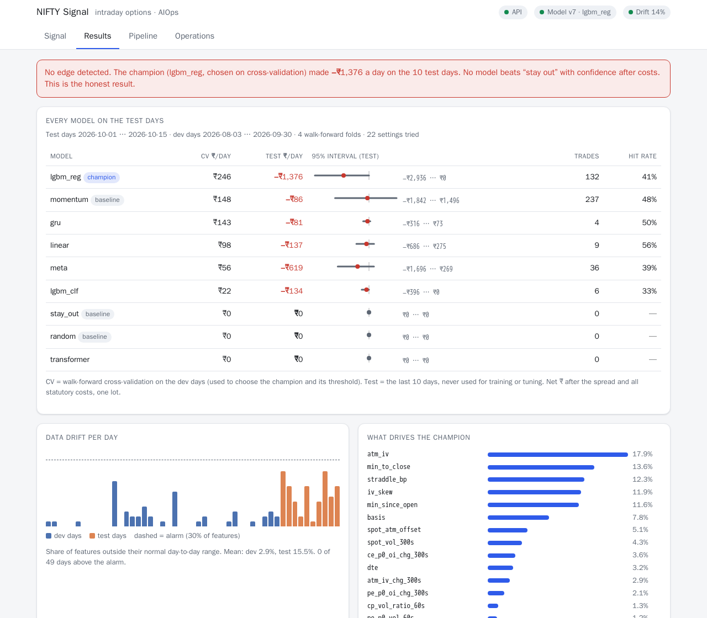
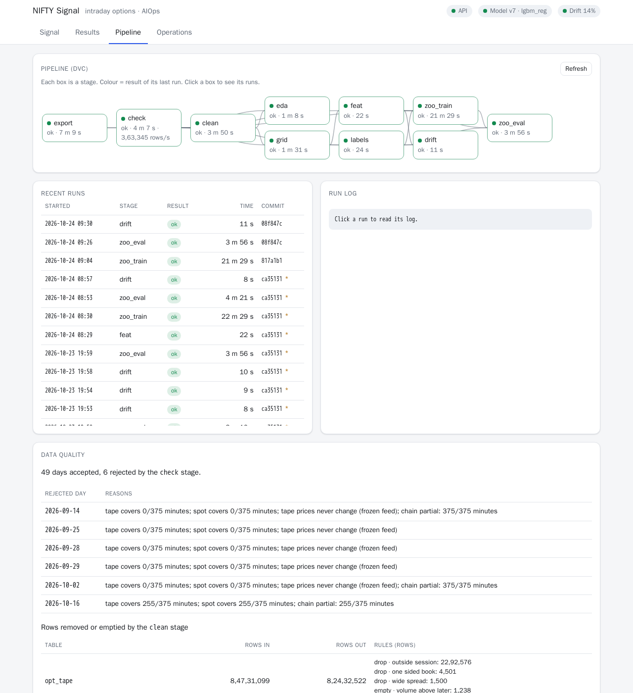
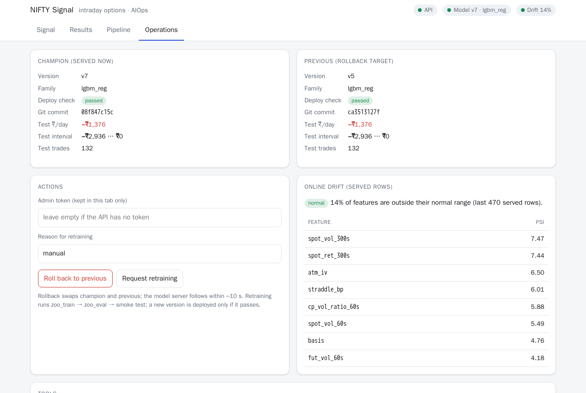
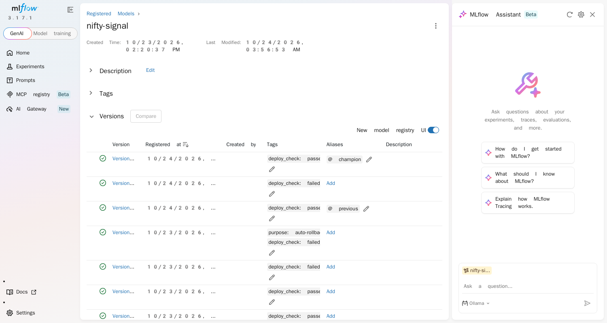

# User manual

For a trader. No programming is needed to use the web page. The operator section at the end is for the
person who runs the server.

Open the page: **http://&lt;server&gt;:8080**. The dots at the top show the state: **API**, **Model**
(version and family), **Drift** (green = normal, orange = watch, red = drift).

## 1. Signal — what would the model do?



1. **Trading day.** Test days are at the top. No model was trained or tuned on them.
2. **Time.** Move the slider, or use −1 min / −1 s / +1 s / +1 min. Entries are possible from 09:20 to 15:15.
3. Press **Get signal**.
   - **BUY CALL** (green), **BUY PUT** (red) or **STAY OUT** (grey).
   - The bars show the expected net ₹ of buying each side now. The black mark is the threshold.
     The model buys only when one side is above it.
4. **What happened next** shows the real result of that trade: bought at the ask, sold at the bid when the
   price touched the take-profit, the stop-loss or the time limit, and the net ₹ for one lot after costs.
   If the model stayed out, it shows what each side would have made (hindsight).
5. **Play** steps through the day one second at a time, like a live feed. After a trade it jumps to the exit
   (one position at a time). **This session** adds up the result.

Tip: the address bar keeps the day and time (`#signal&day=2026-10-13&t=35331`). Send it to share a moment.

The page also works on a phone:


## 2. Results — does the model make money?



- The banner gives the verdict. Now: **no edge detected** on the test days.
- The table lists every model: cross-validation ₹/day (used to choose), test ₹/day, the 95% interval
  (the line; the dot is the result), trades and hit rate. If the interval includes ₹0, the result can be luck.
- **Data drift per day:** how far each day is from the training days (blue = dev, orange = test).
- **What drives the champion:** the most important inputs, and the loss when one input group is removed.

## 3. Pipeline — how the data and models are made



- Each box is a stage; green = its last run succeeded, red = it failed. Click a box to see its runs.
- Click a run to read its log and summary. A `*` after the commit means the code was not committed.
- **Data quality:** the rejected days and why, and the rows that the cleaning rules removed.

## 4. Operations — for the operator



- **Champion** = the model served now. **Previous** = the rollback target. Each shows its deploy check.
- **Roll back to previous:** enter the admin token, press the button, confirm. The server follows in ~10 s.
- **Request retraining:** runs training and evaluation again. A new version is served only if it passes
  the smoke test.
- Links: **MLflow** (experiments and registry), **Grafana** (monitoring), **API reference**.




## 5. Operator: start, stop, update

```bash
./stack up -d --build          # start everything (web 8080, API 8000, MLflow 5050, Grafana 3001)
./stack ps                     # state of each service
./stack down                   # stop (data stays)
./pipe dvc repro               # run the pipeline; zoo_eval deploys a new champion only if it passes
make e2e                       # check the running stack
bash scripts/encrypt_snapshot.sh            # encrypted backup of data + models
```
Settings: `params.yaml`. Admin token: environment variable `ADMIN_TOKEN` (empty = no token).

## 6. Messages

| Message | Meaning | What to do |
|---|---|---|
| cannot reach the API | API container stopped | `./stack up -d api` |
| the model service did not answer | model server starting or down | wait 1 minute; check `./stack logs model` |
| data for … is not available now | the pipeline is rebuilding the data | wait for `dvc repro` to finish |
| admin token missing or wrong | rollback / retrain need the token | enter the token on the Operations tab |
| there is no previous model | nothing to roll back to | — |
